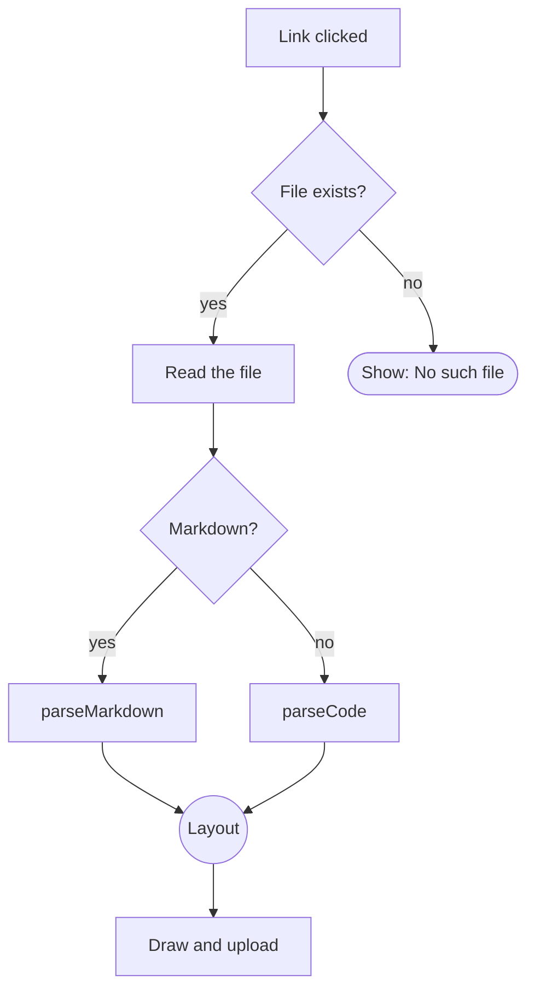
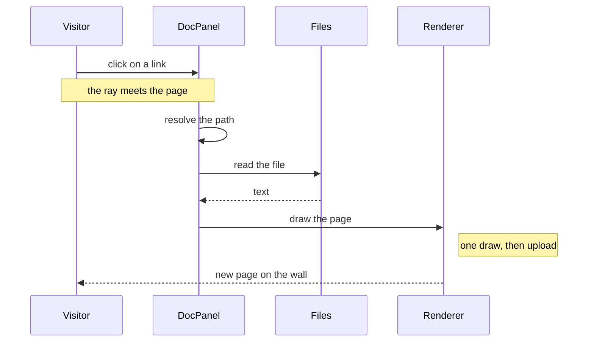
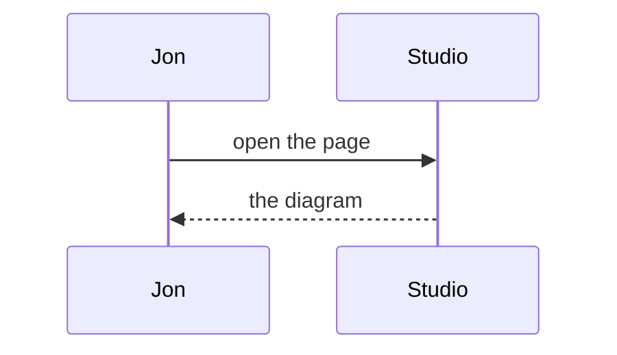

# Mermaid test page

Three real diagrams of how the studio works, drawn natively. The text before and after each one is ordinary page text.

## How a page arrives



That was a top-down flowchart with a diamond, a stadium and a circle.

## The pipeline, left to right

```mermaid
flowchart LR
    src[Mermaid text] --> parse[parser]
    parse --> graph[Graph]
    parse --> seq[SequenceDiagram]
    graph --> layout[layout and route]
    seq --> lay2[layoutSequence]
    layout --> px[Pixels]
    lay2 --> px
    px --> page([The page])
```

## A click on a link



And a short one after it:



The end of the page.
